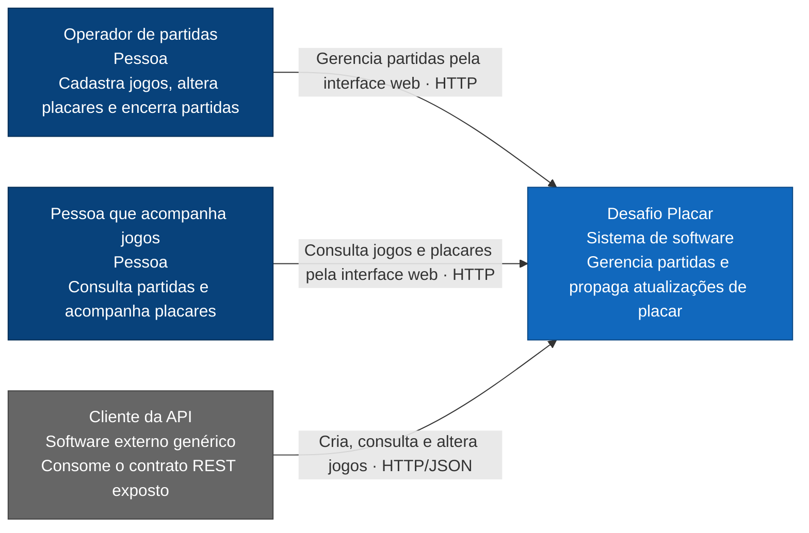
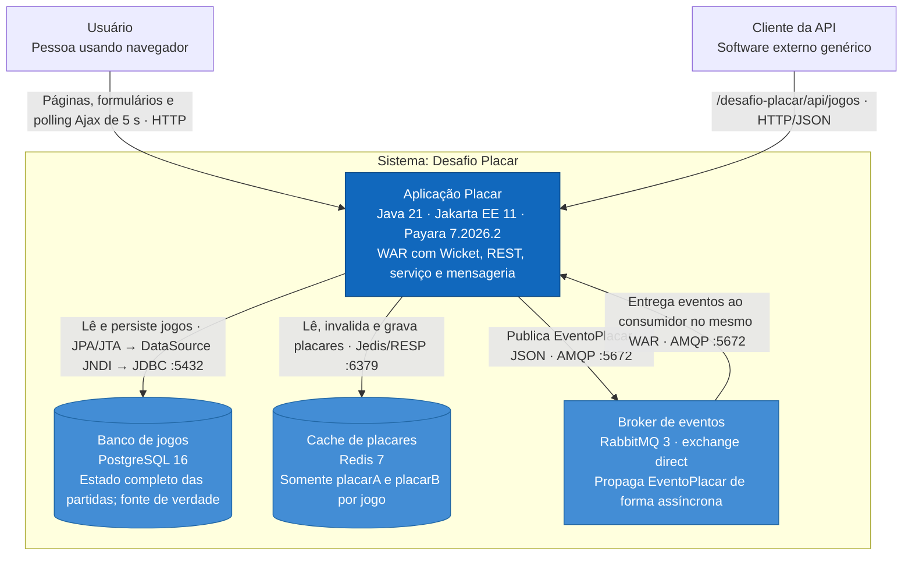
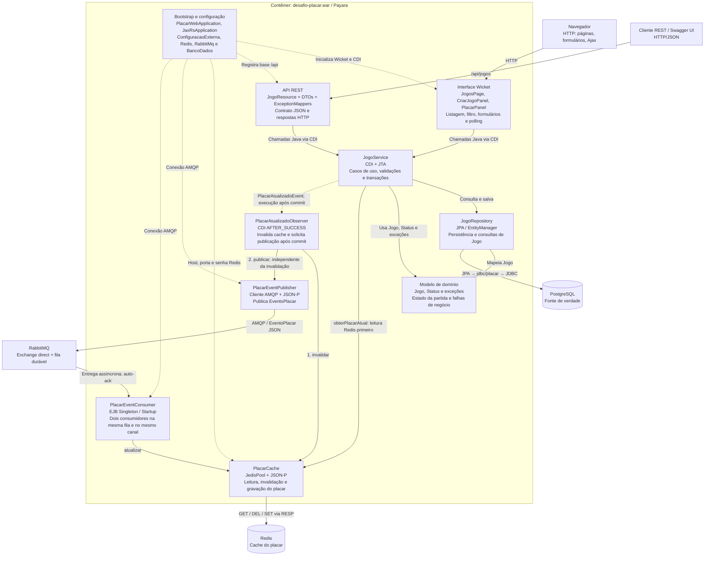
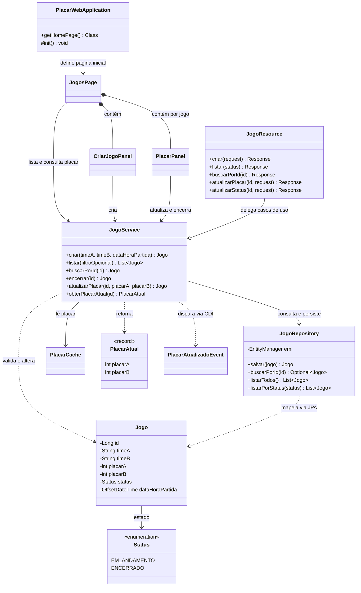
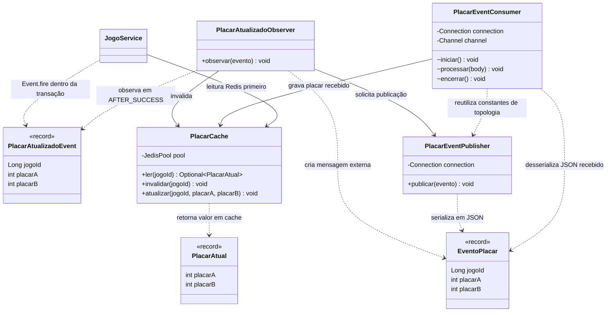
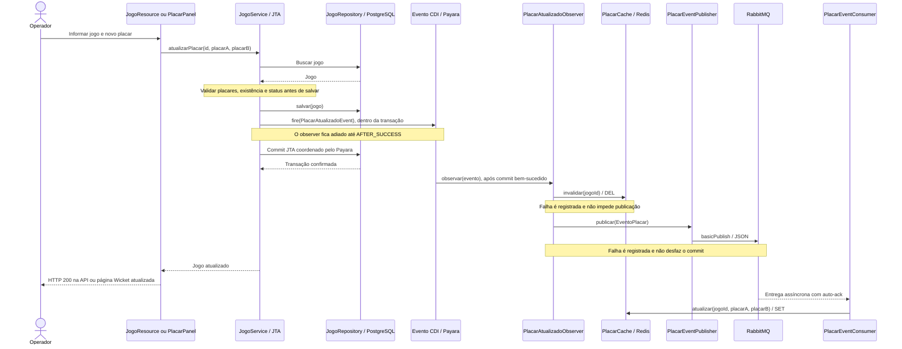
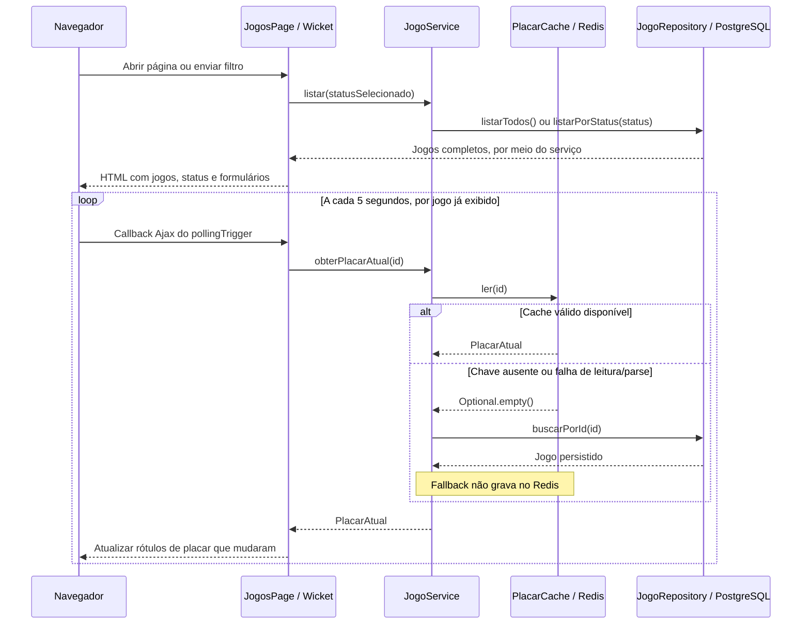
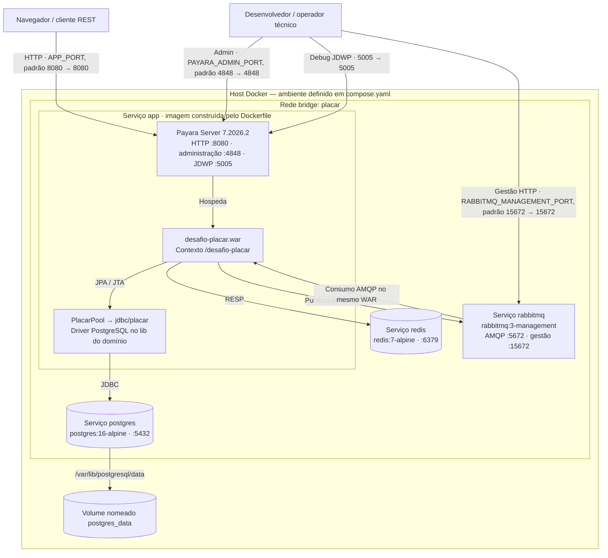

# Modelo C4 — Desafio Placar

Modelo da arquitetura implementada, verificado no código-fonte e na configuração do repositório em 15/10/2026. Abrange contexto (C1), contêineres (C2), componentes (C3), código (C4), fluxos dinâmicos e implantação.

Os [diagramas de sequência UML](sequencia/README.md) complementam as vistas dinâmicas com os fluxos de criação, consulta, atualização de placar, encerramento e polling, em PlantUML editável e SVG.

Os diagramas usam Mermaid, com tipos, tecnologias, responsabilidades e relações explícitos. Podem ser visualizados em um renderizador Markdown com suporte a Mermaid. Nos diagramas estruturais, setas contínuas representam chamadas ou comunicação; setas pontilhadas representam eventos ou dependências de configuração. No nível de código, as relações representam dependências entre classes.

## 1. Escopo e fronteiras

O Desafio Placar permite cadastrar partidas, listar e filtrar jogos, consultar detalhes, substituir placares e encerrar partidas. A interface acompanha os placares por polling Ajax a cada cinco segundos.

O sistema contém uma aplicação Java empacotada em `desafio-placar.war`, um banco PostgreSQL, um cache Redis e um broker RabbitMQ. Interface Wicket, API REST, regras de negócio, publicador e consumidor executam na mesma aplicação e JVM no Payara.

Em C4, um **contêiner** é uma aplicação ou armazenamento executável. Essa definição independe de Docker. Aqui existem quatro contêineres lógicos, que também correspondem aos quatro serviços do Compose. Páginas Wicket e consumidor RabbitMQ são componentes internos do WAR.

Os papéis de operador e pessoa que acompanha jogos descrevem formas de uso; não representam perfis de acesso implementados. O cliente da API representa um consumidor possível da interface pública: o repositório não contém um sistema externo de integração identificado.

## 2. C1 — Contexto do sistema

PostgreSQL, Redis e RabbitMQ pertencem à fronteira do sistema e aparecem no detalhamento C2. Nenhuma dependência de serviço de terceiros hospedado externamente é exigida pela configuração atual.

## 3. C2 — Contêineres

| Contêiner | Responsabilidade e dados | Tecnologia definida no projeto |
| --- | --- | --- |
| Aplicação Placar | Interface, contrato HTTP, regras, transações, publicação e consumo de eventos | Java 21; Jakarta EE 11; Payara 7.2026.2; Wicket 10.11.0 |
| Banco de jogos | Entidade `Jogo`: identificador, times, placares, status e data/hora | PostgreSQL `16-alpine`; driver JDBC 42.7.4; JPA/EclipseLink |
| Cache de placares | Chave `jogo:{id}:placar`, valor JSON com `placarA` e `placarB` | Redis `7-alpine`; Jedis 5.2.0; sem TTL definido no código |
| Broker de eventos | Exchange `placar.exchange`, routing key `placar.atualizado`, fila `placar.atualizado.queue` | RabbitMQ `3-management`; cliente AMQP 5.25.0 |

Swagger UI é uma página estática do WAR, com assets WebJar locais. Consome o documento `/openapi` gerado pelo Payara e permite chamar a API. Não constitui uma aplicação implantada separadamente.

## 4. C3 — Componentes da aplicação Placar

O polling chama `JogoService.obterPlacarAtual` por jogo já exibido. O serviço retorna o cache quando disponível e consulta o PostgreSQL quando a chave está ausente, o JSON é inválido ou o Redis falha. Esse fallback **não repopula o cache**. A API REST de listagem e consulta acessa o repositório pelo serviço; não usa essa leitura de cache.

### Inventário de componentes e arquivos

Todos os pacotes Java abaixo estão sob `src/main/java/com/desafio/placar/`.

| Pacote ou recurso | Elementos | Responsabilidade |
| --- | --- | --- |
| `web` | `PlacarWebApplication`, `JogosPage`, `CriarJogoPanel`, `PlacarPanel` | Bootstrap Wicket/CDI; listagem e filtro; criação; edição de placar e encerramento |
| `src/main/resources/com/desafio/placar/web/` | `JogosPage.html`, `CriarJogoPanel.html`, `PlacarPanel.html`, `placar.css` | Markup e estilo dos componentes Wicket |
| `api` | `JogoResource` | Recebe requisições, valida presença de dados e converte `Jogo` em `JogoResponse` |
| `api.dto` | `CriarJogoRequest`, `AtualizarPlacarRequest`, `AtualizarStatusRequest`, `JogoResponse`, `ErroResponse` | Contratos de entrada e saída |
| `api.mapper` | `EntradaInvalidaExceptionMapper`, `NaoEncontradoExceptionMapper`, `JogoEncerradoExceptionMapper`, `ErroGenericoExceptionMapper` | Converte falhas em HTTP 400, 404, 409 e tratamento de erros genéricos |
| `service` | `JogoService` | Valida regras e coordena repositório, leitura do cache e emissão do evento CDI |
| `domain` | `Jogo`, `Status` | Entidade JPA e estados `EM_ANDAMENTO` / `ENCERRADO` |
| `domain.excecao` | `EntradaInvalidaException`, `NaoEncontradoException`, `JogoEncerradoException` | Erros de entrada, ausência de jogo e restrição de alteração |
| `persistence` | `JogoRepository` | `persist`, `merge`, busca por ID, listagem total e filtro por status |
| `cache` | `PlacarCache`, `PlacarAtual` | Adaptador Redis e record com os dois placares |
| `messaging` | `PlacarAtualizadoEvent`, `PlacarAtualizadoObserver` | Evento CDI interno e reação transacional após commit |
| `messaging` | `EventoPlacar`, `PlacarEventPublisher`, `PlacarEventConsumer` | Mensagem externa JSON, publicação e consumo AMQP |
| `config` | `JaxRsApplication` | Ativa JAX-RS em `/api` e declara metadados OpenAPI |
| `config` | `ConfiguracaoExterna`, `ConfiguracaoRedis`, `ConfiguracaoRabbitMq` | Resolve propriedade da JVM → variável de ambiente → padrão |
| `config` | `ConfiguracaoBancoDados` | Documenta a constante JNDI `jdbc/placar`; não cria o DataSource |
| `src/main/resources/META-INF/persistence.xml` | Unidade `placarPU` | JTA, recurso `jdbc/placar`, entidade `Jogo` e geração/extensão de schema pelo EclipseLink |
| `src/main/webapp/WEB-INF/web.xml` | `WicketFilter` em `/*` | Configuração Servlet da interface |
| `src/main/webapp/swagger/index.html` | Swagger UI | Documentação interativa, com assets WebJar e documento `/openapi` |

## 5. C4 — Código

O detalhamento de código é dividido em duas vistas para manter a leitura. Exibe as classes centrais e suas dependências; DTOs, mappers, configuração e recursos complementares estão inventariados acima. Operações são resumidas, sem reproduzir getters, setters ou construtores auxiliares.

### 5.1. Casos de uso, apresentação e persistência

As regras ficam em `JogoService`: criação com campos obrigatórios, placar inicial 0 × 0 e status `EM_ANDAMENTO`; rejeição de placares negativos; bloqueio de alteração de placar de jogo encerrado; encerramento idempotente. `Jogo` mantém o estado e o mapeamento JPA. Criar, alterar placar e encerrar usam `@Transactional`; somente alterar placar dispara o evento CDI.

### 5.2. Eventos e cache

`PlacarAtualizadoEvent` é um evento em memória no processo. `EventoPlacar` cruza a fronteira do processo via RabbitMQ, com corpo `{"jogoId":10,"placarA":2,"placarB":1}`. O consumidor não chama o publicador para processar mensagens: a dependência de código entre eles serve apenas para compartilhar as constantes de exchange, fila e routing key.

## 6. Vistas dinâmicas

### 6.1. Alteração de placar e propagação após commit

A entrega pelo broker pode ocorrer antes ou depois da resposta ao operador; o desenho apresenta uma ordem possível. O observer transacional não é um worker separado: usa `@Observes`, e a assincronia entre publicação e consumo ocorre no RabbitMQ. Se a transação sofrer rollback, o observer `AFTER_SUCCESS` não executa.

### 6.2. Consulta e polling da interface

O timer não recarrega a lista, não cria novas linhas, não atualiza status e não sobrescreve os campos de edição. Falhas por jogo preservam o último placar visível e permitem continuar os próximos ciclos. Mudanças de status ou novos jogos vindos de outro cliente exigem nova carga da listagem para aparecerem.

## 7. Implantação — Docker Compose

As portas 5432, 6379 e 5672 ficam internas à rede Compose. O `compose.yaml` consultado também publica a porta de depuração 5005. Apenas PostgreSQL tem volume nomeado configurado; Redis e RabbitMQ não têm volumes de persistência declarados no Compose.

O Dockerfile usa um estágio Maven/JDK 21 para executar `mvn clean package`, incluindo os testes, e copia o WAR e o driver JDBC para a imagem Payara. O script [`01-gerar-datasource.sh`](../../docker/payara/init.d/01-gerar-datasource.sh) gera comandos de post-boot na ordem pool → recurso JNDI → deploy, respeitando recursos já existentes no domínio.

O serviço `app` depende dos healthchecks de PostgreSQL, Redis e RabbitMQ. Seu próprio healthcheck exige HTTP 200 em `/desafio-placar/api/jogos`. Redis e RabbitMQ são configurados pela aplicação via propriedades JVM ou variáveis de ambiente. As variáveis de banco alimentam o script de configuração do Payara; a aplicação recebe a conexão pelo DataSource JNDI.

| Interface | Caminho ou porta padrão |
| --- | --- |
| Interface Wicket | `http://localhost:8080/desafio-placar/` |
| API REST | `http://localhost:8080/desafio-placar/api/jogos` |
| Swagger UI | `http://localhost:8080/desafio-placar/swagger/` |
| Documento OpenAPI do Payara | `http://localhost:8080/openapi` — fora do contexto do WAR |
| Administração Payara | `http://localhost:4848` |
| Gestão RabbitMQ | `http://localhost:15672` |
| Depuração JVM | `localhost:5005` |

## 8. Contrato e regras relevantes para a arquitetura

Base: `/desafio-placar/api/jogos`. Os DTOs usam JSON.

| Operação | Endpoint | Caminho interno e comportamento |
| --- | --- | --- |
| Criar partida | `POST /` | `JogoResource → JogoService.criar → JogoRepository`; retorna 201 com placar 0 × 0 e status `EM_ANDAMENTO` |
| Listar partidas | `GET /?status=...` | Serviço → repositório; filtro opcional `EM_ANDAMENTO` ou `ENCERRADO`; retorna 200 |
| Buscar partida | `GET /{id}` | Serviço → repositório; retorna 200 ou 404 |
| Substituir placar | `PUT /{id}/placar` | Transação → evento CDI → pós-commit → Redis/RabbitMQ; retorna 200, 400, 404 ou 409 |
| Encerrar partida | `PUT /{id}/status` | Aceita somente `ENCERRADO`; transação sem evento de placar; operação idempotente; retorna 200, 400 ou 404 |

As operações da interface Wicket chamam os mesmos métodos do serviço diretamente via CDI. Não existe chamada HTTP interna entre Wicket e REST.

## 9. Consistência e limites da implementação

- **Fonte de verdade:** PostgreSQL mantém o jogo completo. Redis contém uma projeção dos dois placares e pode ficar atrasado.
- **Fronteira transacional:** somente a persistência do jogo participa da transação JTA. Invalidação de cache e publicação ocorrem depois do commit e falham de forma independente.
- **Entrega de mensagens:** exchange e fila são duráveis, mas a publicação usa propriedades `null`, sem marcar a mensagem como persistente e sem publisher confirms. O consumidor usa auto-ack; não há garantia de processamento bem-sucedido no Redis.
- **Recuperação:** não há Outbox, retry de negócio, dead-letter, deduplicação ou transação distribuída. O publisher tenta obter conexão no uso quando necessário. O consumer não possui agendador próprio de reconexão se falhar ao abrir a conexão inicial; a recuperação nativa do cliente não substitui esse primeiro estabelecimento.
- **Ordem e cache:** mensagens não carregam versão nem timestamp e a gravação Redis é um `SET` sem comparação. Não há proteção explícita contra um evento antigo sobrescrever um placar mais recente. Sem TTL ou reconciliação periódica, um cache válido porém desatualizado pode continuar sendo servido; o fallback só ocorre na ausência ou falha de leitura do cache.
- **Atualização visual:** o polling é de cinco segundos e atualiza apenas os rótulos dos placares dos jogos já carregados. Esse intervalo não constitui garantia de latência de ponta a ponta.
- **Acesso:** o código e a configuração inspecionados não definem autenticação, autorização por perfil ou terminação TLS. Os atores do C1 não implicam controle de permissões.

## 10. Rastreabilidade e verificação

| Fonte | Parte do modelo sustentada |
| --- | --- |
| [`pom.xml`](../../pom.xml) | WAR, Java e versões das dependências |
| [`compose.yaml`](../../compose.yaml) e [`Dockerfile`](../../Dockerfile) | Serviços, rede, volume, portas, healthchecks e build/deploy |
| [`JogoService.java`](../../src/main/java/com/desafio/placar/service/JogoService.java) | Casos de uso, transações, evento CDI e fallback de leitura |
| [`JogoResource.java`](../../src/main/java/com/desafio/placar/api/JogoResource.java) | Endpoints, validações HTTP e DTOs |
| [`JogosPage.java`](../../src/main/java/com/desafio/placar/web/JogosPage.java) | Polling, intervalo e atualização parcial da interface |
| [`JogoRepository.java`](../../src/main/java/com/desafio/placar/persistence/JogoRepository.java) e [`Jogo.java`](../../src/main/java/com/desafio/placar/domain/Jogo.java) | Consultas e modelo persistido |
| [`PlacarCache.java`](../../src/main/java/com/desafio/placar/cache/PlacarCache.java) | Chaves, payload, ausência de TTL e tratamento de falhas |
| [`PlacarAtualizadoObserver.java`](../../src/main/java/com/desafio/placar/messaging/PlacarAtualizadoObserver.java) | Fase `AFTER_SUCCESS` e independência entre invalidação e publicação |
| [`PlacarEventPublisher.java`](../../src/main/java/com/desafio/placar/messaging/PlacarEventPublisher.java) e [`PlacarEventConsumer.java`](../../src/main/java/com/desafio/placar/messaging/PlacarEventConsumer.java) | Topologia AMQP, conexões, dois consumidores e auto-ack |
| [`persistence.xml`](../../src/main/resources/META-INF/persistence.xml) | `placarPU`, JTA, `jdbc/placar` e schema |
| [`src/test/java/com/desafio/placar/`](../../src/test/java/com/desafio/placar/) | Testes unitários de serviço, API, observer, consumer e componentes Wicket, com fakes e WicketTester |

Este modelo descreve o conteúdo do repositório, sem comprovar disponibilidade de serviços em execução. Os testes unitários não representam um teste integrado de Payara, PostgreSQL, Redis e RabbitMQ. Para manter a documentação, revisar estes diagramas quando houver mudança de fronteira do WAR, componentes, payload de evento, estratégia de cache ou implantação.
