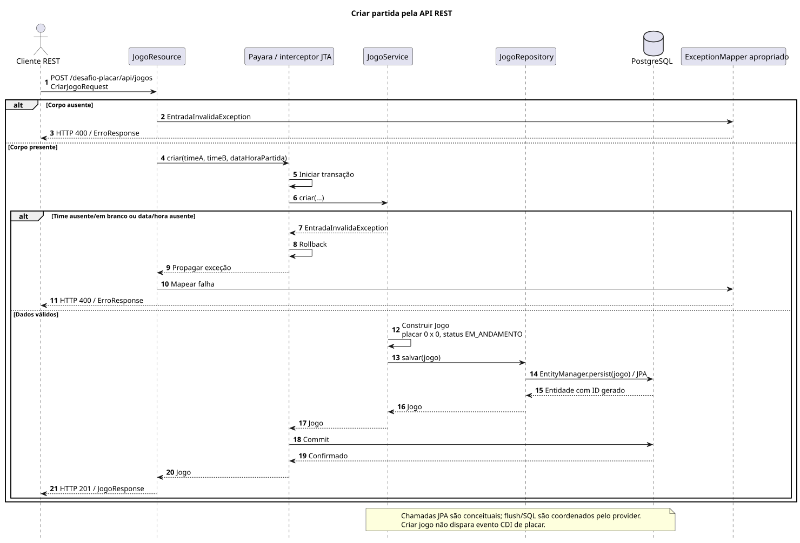
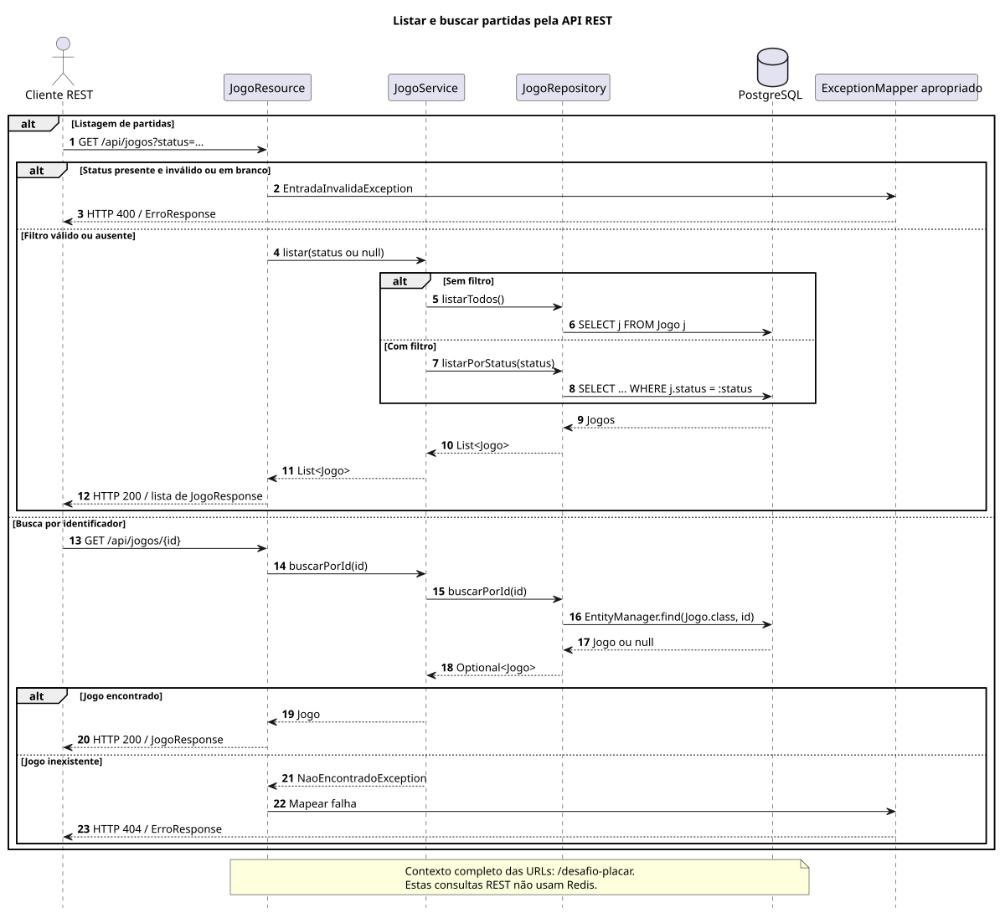
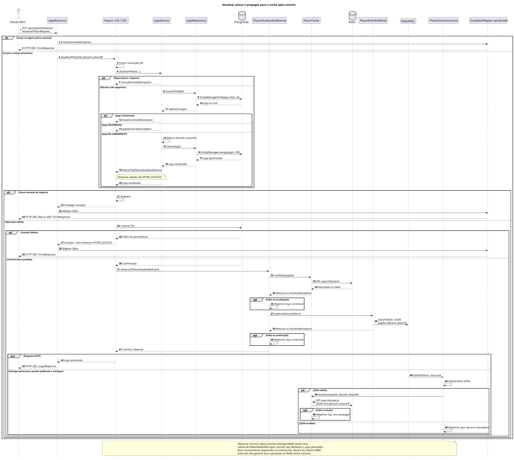
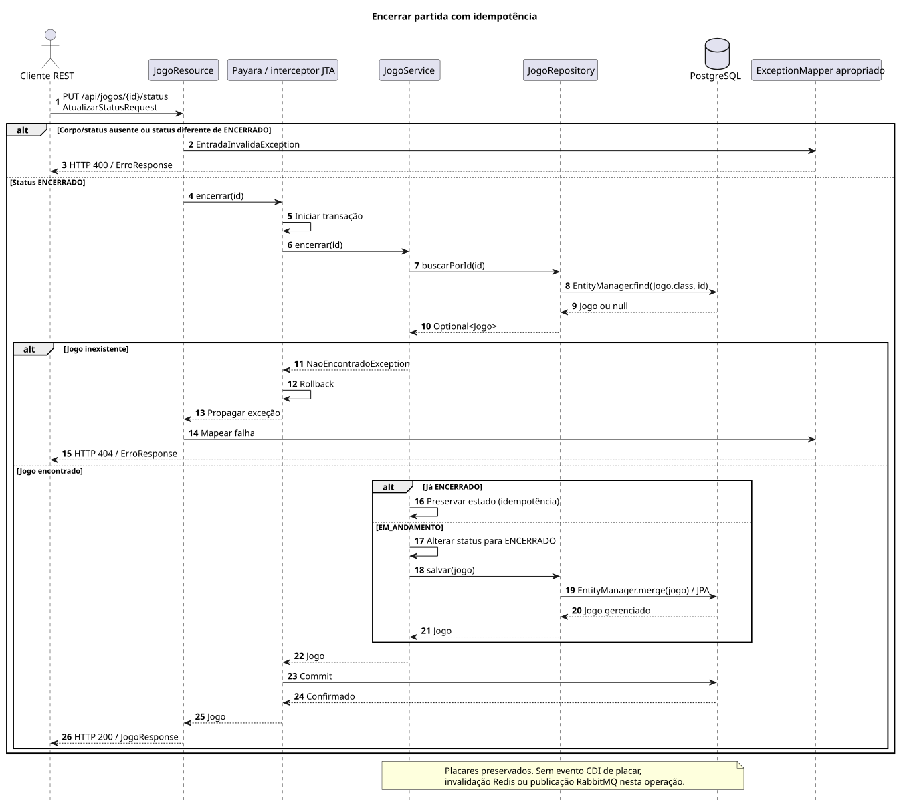
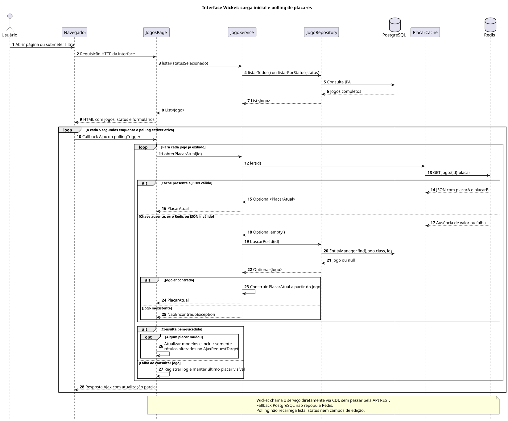

# Diagramas de sequência UML

Complemento ao [modelo C4](../c4-model.md), baseado nos métodos implementados no projeto. O [arquivo PlantUML editável](diagramas.puml) contém cinco diagramas; as versões SVG abaixo permitem visualizar e ampliar os fluxos sem instalar uma extensão.

## Criar partida

Validação, transação JTA e persistência pela API, incluindo entradas inválidas.



## Consultar partidas

Listagem com filtro opcional e busca por identificador. Essas consultas REST leem PostgreSQL pelo serviço e repositório.



## Atualizar placar

Fluxo principal de ponta a ponta: validações, commit, evento CDI `AFTER_SUCCESS`, invalidação do Redis, publicação RabbitMQ e consumo assíncrono para atualizar o cache. Inclui erros de entrada, jogo inexistente, jogo encerrado e falhas de integração.



## Encerrar partida

Encerramento idempotente, preservando placares e sem emitir evento de atualização de placar.



## Interface e polling

Carga inicial da página Wicket e polling Ajax a cada cinco segundos, com Redis primeiro e fallback PostgreSQL por jogo exibido.



## Convenções e escopo

- Setas contínuas indicam chamadas síncronas; setas tracejadas, retornos; a seta de ponta aberta indica entrega assíncrona pelo broker.
- `alt` representa caminhos alternativos, `opt` um trecho condicional, `loop` uma repetição e `par` atividades cuja ordem relativa não é garantida.
- O participante Payara/JTA representa o interceptor transacional do contêiner; o serviço não executa `commit` manualmente.
- As chamadas JPA resumem a persistência. A ordem exata dos comandos SQL e o momento do flush dependem do provider.
- Retornos HTTP passam pelo runtime JAX-RS. Os mappers são representados como parte desse tratamento, sem implicar chamadas explícitas a eles pelo resource.
- Os fluxos REST usam o prefixo `/desafio-placar`. Na interface, `CriarJogoPanel` e `PlacarPanel` chamam os mesmos métodos do serviço via CDI; as falhas são exibidas pela página, em vez de convertidas pelos mappers REST.
- Criação e encerramento mostram commit bem-sucedido no caminho normal. Erros inesperados REST são tratados pelo mapper genérico; o diagrama de atualização também explicita uma falha de commit.

Para regenerar os SVGs com PlantUML instalado:

```powershell
java -jar plantuml.jar -charset UTF-8 -tsvg docs/arquitetura/sequencia/diagramas.puml
```

Os nomes dos arquivos de saída são definidos nos blocos `@startuml`.
