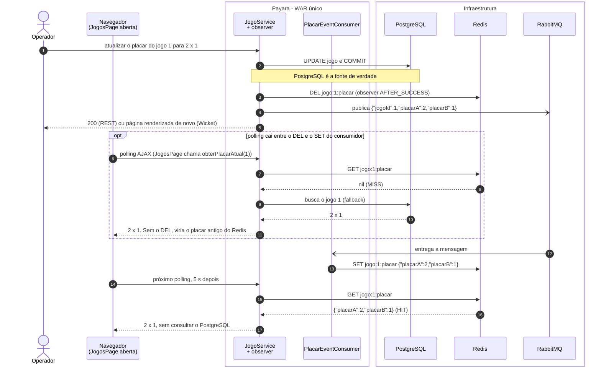
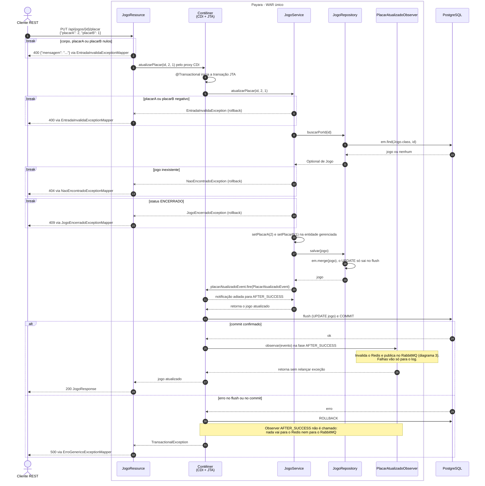
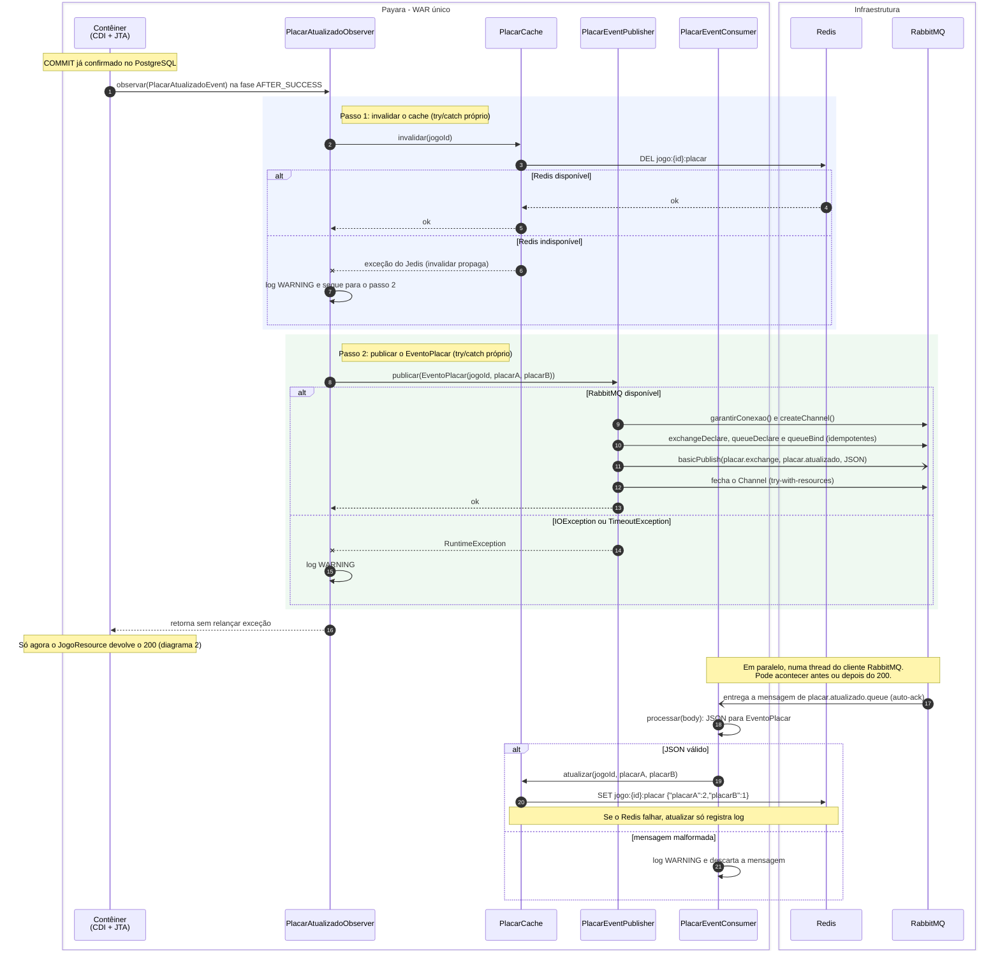
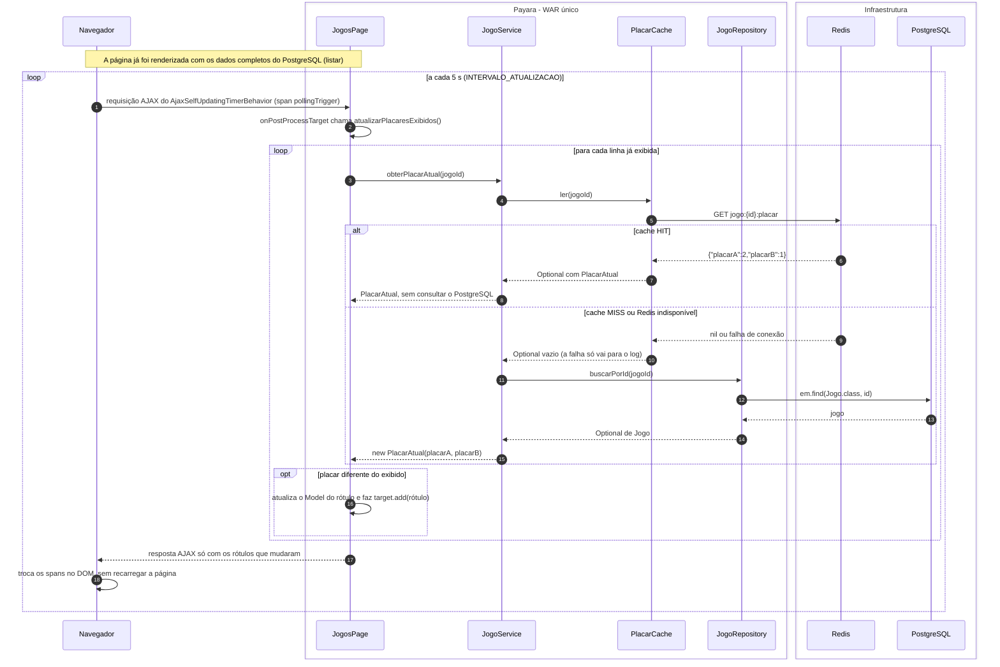
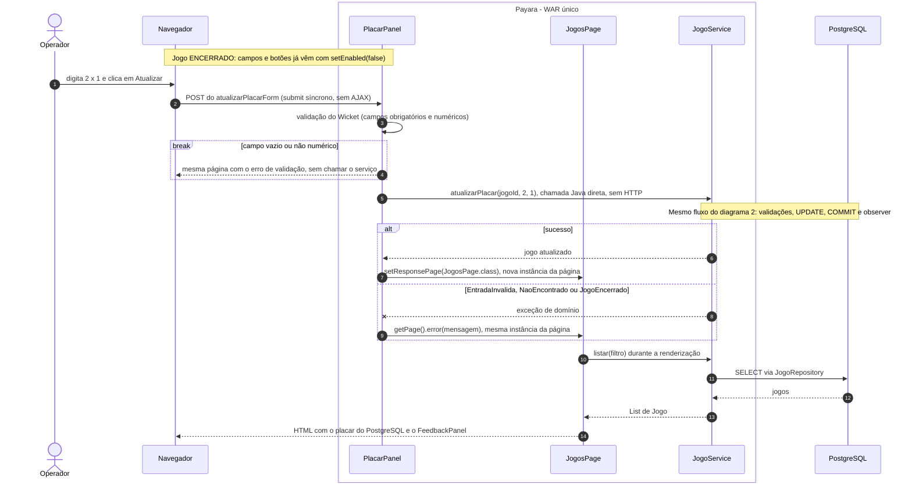
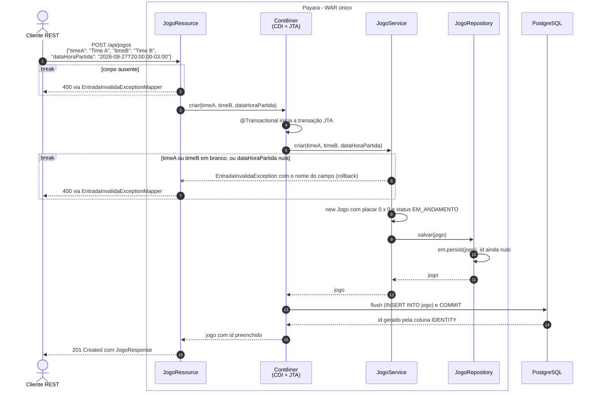
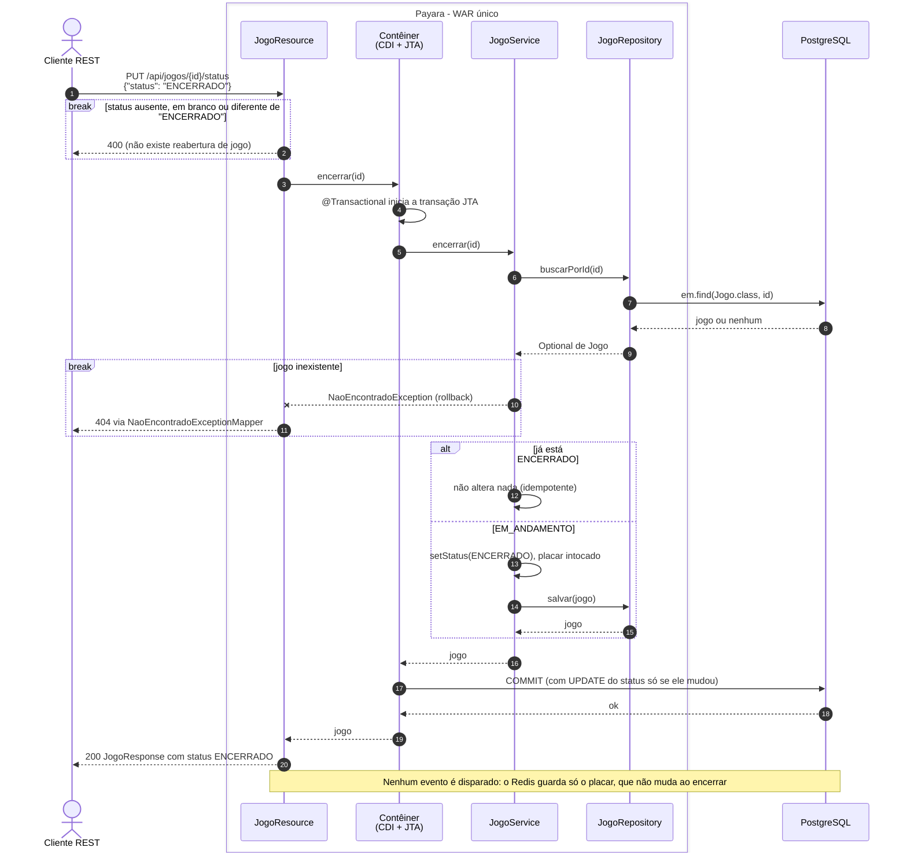
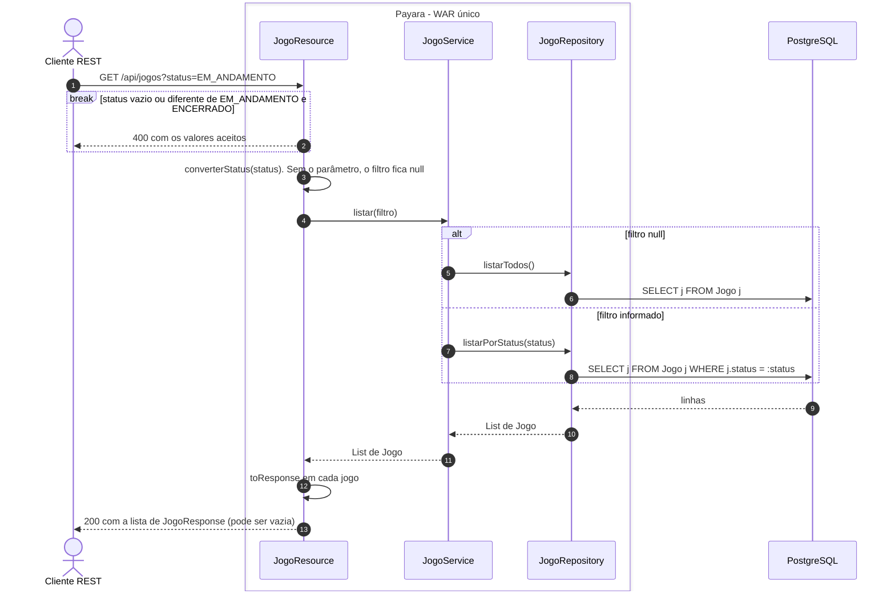
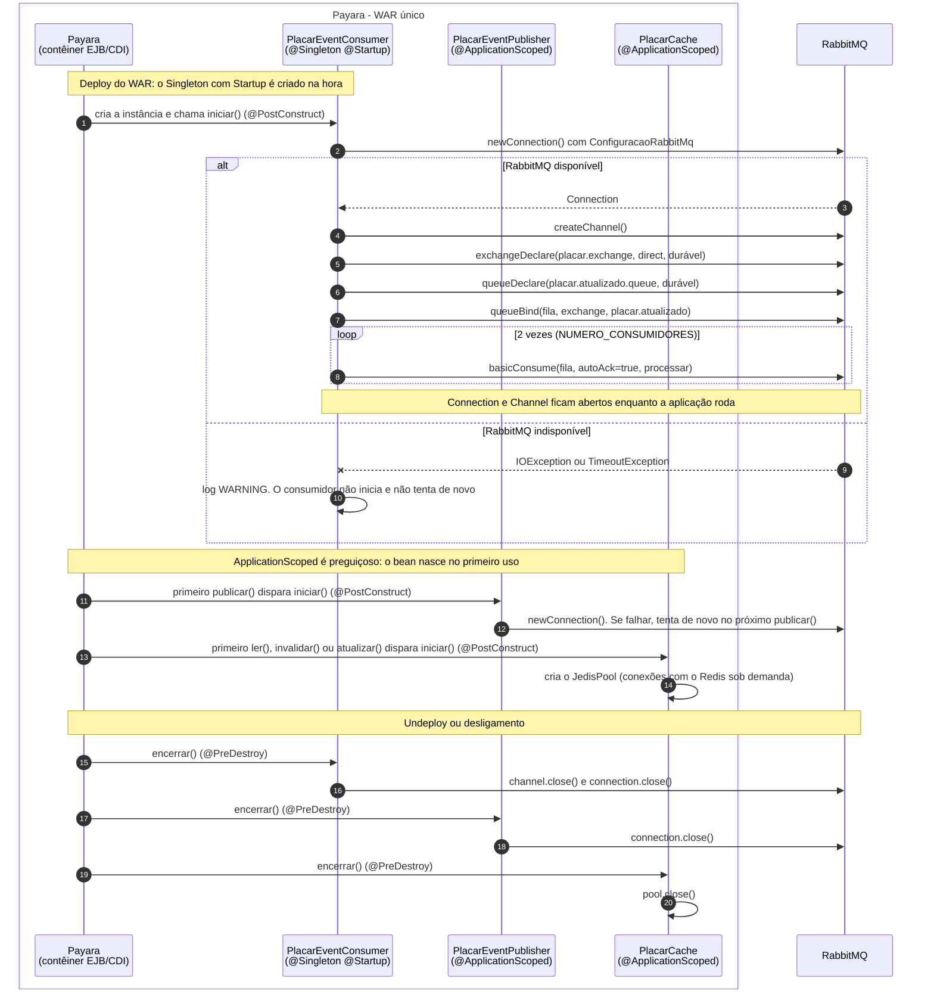

# Diagramas de sequência

Fluxos principais do Desafio Placar, desenhados a partir do código atual (nomes reais de classes e métodos). Os caminhos HTTP são relativos a `http://localhost:8080/desafio-placar`.

Como ler os diagramas:

| Elemento | Significado |
|---|---|
| Linha cheia com seta | Chamada síncrona |
| Linha tracejada com seta | Retorno |
| Linha cheia com seta aberta | Mensagem assíncrona: quem envia não espera resposta |
| Linha tracejada terminando em X | Exceção propagada |
| `break` | Caminho de erro: o fluxo termina ali |
| `alt` / `opt` / `loop` / `par` | Alternativas, trecho opcional, repetição |
| Contêiner (CDI + JTA) | Proxy CDI, interceptor `@Transactional` e despacho de eventos CDI, fornecidos pelo Payara |

## 1. Visão geral: do placar atualizado até a tela

- O PostgreSQL é gravado e confirmado antes de qualquer integração. Redis e RabbitMQ só entram depois do commit.
- O `DEL` existe para a tela não ler o placar antigo do Redis entre o commit e o `SET` do consumidor (Requisito 7.5).
- Sem Redis, a leitura cai no PostgreSQL. Sem RabbitMQ, o cache só deixa de ser preenchido. Nenhum dado oficial se perde.

## 2. Atualizar placar pela API REST

- Ordem das validações: campos nulos no `JogoResource` (400), placar negativo (400), jogo inexistente (404), jogo `ENCERRADO` (409). Em todos esses casos o evento nem chega a ser disparado.
- O `fire` acontece dentro da transação, mas o observer só roda depois do `COMMIT`. Se o commit falhar, nada é publicado. É por isso que se usa `AFTER_SUCCESS` em vez de publicar direto no método.
- O observer roda na mesma thread da requisição, antes do 200. A latência de Redis e RabbitMQ entra no tempo de resposta, mas falhas deles não mudam o status HTTP.

## 3. Depois do commit: invalidação, publicação e consumo

Pontos de atenção:

- Os dois passos do observer são independentes, cada um com seu `try/catch`. No `PlacarCache`, só `invalidar` propaga falha; `ler` e `atualizar` apenas registram log.
- A entrega não é garantida, por escolha de escopo: não há publisher confirms, a mensagem é publicada sem propriedades (não persistente, embora a fila seja durável) e o consumo usa `auto-ack`. Uma perda deixa o cache vazio (a leitura vai ao PostgreSQL) ou, se a invalidação também falhou, desatualizado. O PostgreSQL nunca é afetado.
- Os 2 consumidores dividem o mesmo `Channel`. O cliente Java do RabbitMQ entrega as mensagens de um canal em ordem, uma de cada vez ([guia do cliente Java](https://www.rabbitmq.com/client-libraries/java-api-guide)). Na prática não há processamento paralelo, mas a ordem da fila é preservada.
- O publisher abre um `Channel` e redeclara a topologia a cada publicação. É simples e seguro entre threads, mas custa idas e voltas extras ao broker. O mesmo guia desaconselha abrir um canal por mensagem.
- Duas atualizações concorrentes do mesmo jogo podem ser publicadas fora de ordem. Sem versionamento nem TTL na chave, o Redis pode ficar com o valor anterior até a próxima atualização. É uma limitação aceita no design.

## 4. Atualização automática da tela (polling)

- O timer fica num `span` neutro (`pollingTrigger`), fora da tabela e dos formulários. Só os rótulos que mudaram entram na resposta AJAX, então o que o usuário está digitando não é apagado.
- A `JogosPage` não sabe se o valor veio do Redis ou do PostgreSQL. Essa decisão é do `JogoService.obterPlacarAtual`. Uma falha em uma linha só vai para o log e o último valor exibido é mantido.
- O polling atualiza apenas `placarA` e `placarB`. Status e jogos criados por outro cliente só aparecem na próxima renderização completa (filtro, criação ou ação na tela).
- Custo: uma leitura por jogo exibido a cada 5 s, por aba aberta.

## 5. Operações pela interface Wicket

- A interface chama o `JogoService` direto, na mesma JVM, sem passar pela API REST. Por isso as regras são as mesmas nos dois caminhos.
- Para jogo `ENCERRADO` os controles já vêm desabilitados (Requisito 6.2), mas a garantia real é o `JogoService`: se outro cliente encerrar o jogo com a página aberta, a tentativa recebe `JogoEncerradoException` e a mensagem aparece no `FeedbackPanel`.
- Criar (`CriarJogoPanel`, que combina `datetime-local` e offset em um `OffsetDateTime`) e Encerrar seguem o mesmo padrão: submit síncrono, `criar(...)` ou `encerrar(id)`, `setResponsePage` no sucesso e `error(...)` na falha.

## 6. Criar jogo pela API REST

- Com `GenerationType.IDENTITY`, o id é gerado pelo PostgreSQL no `INSERT`. O EclipseLink só envia o `INSERT` no flush, então o id fica disponível depois do commit, que é quando o `JogoResource` monta a resposta.

## 7. Encerrar jogo pela API REST

- Única transição suportada: `EM_ANDAMENTO` para `ENCERRADO`. Repetir o pedido devolve 200 sem alterar nada (Requisito 5.3).

## 8. Listar e filtrar pela API REST

- `listar` e `buscarPorId` não são `@Transactional`: são leituras simples, sem transação.
- `GET /api/jogos/{id}` faz o mesmo caminho até `JogoRepository.buscarPorId` e devolve 404 quando o jogo não existe, como no diagrama 7.

## 9. Ciclo de vida das integrações

- O consumidor é EJB `@Singleton` + `@Startup` para começar a ouvir a fila já no deploy. Publisher e cache são `@ApplicationScoped`, criados no primeiro uso.
- Se o RabbitMQ estiver fora no deploy, o consumidor não inicia: a recuperação automática do cliente não vale para a primeira conexão ([guia do cliente Java](https://www.rabbitmq.com/client-libraries/java-api-guide)). No Docker Compose isso é evitado porque o Payara só sobe depois do healthcheck do RabbitMQ.
- Depois de conectado, quedas de rede são cobertas pela recuperação automática do cliente, que reabre conexão, canal e consumidores.
